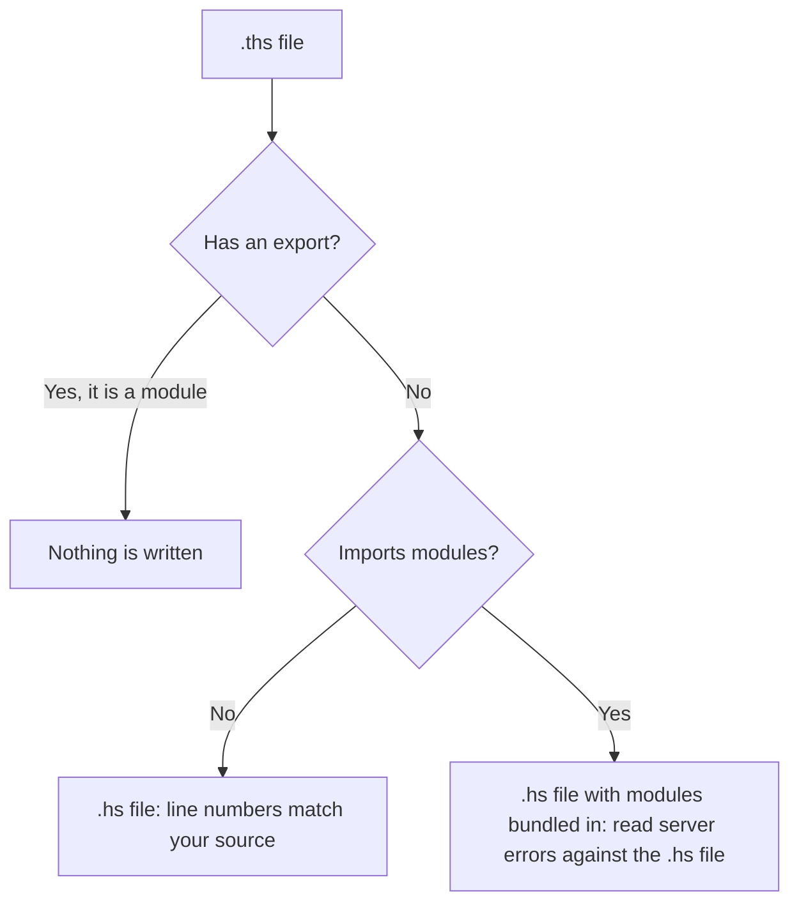

# Typed HaasScript

TypeScript-style type annotations and type checking for HaasScript, the Lua-based scripting language of HaasOnline TradeServer.

> [!NOTE]
> **Status: alpha.** `ths check` and `ths strip` work. Please [report problems as issues](https://github.com/Haasonline/typed-haasscript/issues).

```lua
local function average(prices: number[], period: number): number
  ...
end
```

Write scripts in `.ths` files with type annotations, check them with `ths check`, and strip the annotations with `ths strip` to get a `.hs` file you can upload to the TradeServer.

## Usage

| Command | What it does |
|---|---|
| `ths check src/trend-bot.ths` | Checks that file. A plain `.lua` or `.hs` file reports only what the server rejects; rename it to `.ths` to see the rest. |
| `ths check src/` | Checks every `.ths`, `.lua` and `.hs` file below `src/`. |
| `ths check --strict src/trend-bot.ths` | Also reports parameters and variables left as an unchecked `any`. |
| `ths check --shadowing src/trend-bot.ths` | Also warns where a read falls back past a local that ended with its block. |
| `ths strip src/trend-bot.ths` | Writes `src/trend-bot.hs`. |
| `ths init` | Makes the current directory a project: writes a `ths.toml` listing every setting, switched off. |
| `ths check` | Checks every file the project's `ths.toml` includes. |
| `ths strip` | Strips every `.ths` file the project includes. |

## Stripping



Stripping replaces annotations with spaces, so line numbers in TradeServer errors match your source. A script that imports modules (`import { average } from "./math/averages"`) is written with those modules bundled in; a bundle's lines do not match the source, so read server errors against the `.hs` file. A module, a `.ths` file with an `export`, is never uploaded, so nothing is written for it.

As in TypeScript, `ths strip` writes its output even when there are type errors unless `refuse_output_on_errors` is set, and it replaces any `.hs` file already at the output path. A `.hs` file beside a `.ths` file of the same name is taken to be its stripped output and is never checked.

## Project settings

A `ths.toml` plays the part of TypeScript's `tsconfig.json`. `ths check` and `ths strip` use the nearest one in the current directory or above it, or the one `--project` names. Without file arguments they work on the files it includes; with file arguments its settings still apply. Every key is optional, and an unknown key is an error. `ths init` writes one with every key commented out, and never replaces one that exists.

```toml
include = ["src"]              # files and directories, as glob patterns; default: everything
exclude = ["src/vendor"]
output = "build"               # where stripped .hs files go; default: beside each .ths file
root = "src"                   # the layout output copies; default: the common directory of the stripped files

[check]
strict = true                  # as --strict
shadowing = false              # as --shadowing
refuse_output_on_errors = true # ths strip writes nothing while any file has an error
```

Files and directories whose names start with a dot are skipped.

## Custom commands

Custom commands need no import. Every file in the project that calls `DefineCommand`, typed or plain, declares its `CC_` command for all the others, with the parameter types read from its `DefineParameter` calls and the result types from its `DefineOutput` and `DefineOutputIndex` calls and the values it gives them, so a command that returns `SMA(…)` gives callers a series. Inside a command, each `DefineParameter` call has the type the parameter receives, such as a number for `NumberType`. The project's `.d.ths` files are loaded as declarations too, for commands that are not in the project.

## Tools

- `ths`: the terminal command (`check`, `strip`, `init`, `server`)
- A VSCode extension, in [editors/vscode](editors/vscode): errors as you type and syntax highlighting
- A JetBrains plugin, in [editors/jetbrains](editors/jetbrains), for PyCharm and every other IntelliJ-based IDE from 2026.2: errors as you type and the same syntax highlighting

`ths check` knows every built-in HaasScript command, enumeration and result container from the declarations shipped inside it. `ths server` is a language server that reports the same errors as you type and answers hover, go-to-definition and completion, and the VSCode extension in [editors/vscode](editors/vscode) and the JetBrains plugin in [editors/jetbrains](editors/jetbrains) drive it. See [docs/design.md](docs/design.md).

## Language server

`ths server` speaks the Language Server Protocol over standard input and output, for any editor that can run a language server. Each open file is checked as `ths check` checks it, from the nearest `ths.toml` above it; a file with no `ths.toml` above it is not checked, and the editor plugins offer to create one.

- **Unsaved edits:** each file sees the unsaved text of the other open files, so a script shows at once what a change to a module it imports does to it.
- **Hover:** shows how a name was declared, its type where it is written and the comment above its declaration.
- **Go-to-definition:** leads to a name's declaration, through an import to the export in the module.
- **Completion:** offers the names in scope, and after a `.` or `:` the fields and methods of the value before it.

## Building

```sh
cargo build
```

## Built-in declarations

`ths check` reads the built-in commands from two files in `crates/ths-check/declarations/`, both compiled into the `ths` binary:

- `haasscript.d.ths` is generated from the TradeServer's command list. Never edit it by hand.
- `overrides.d.ths` holds hand-written corrections. A name declared there replaces the generated declaration of the same name, so regenerating keeps every correction. Each override rests on behavior verified on the TradeServer.

The generated file is updated when the TradeServer's commands change. After an update, rebuild `ths` so it embeds the new declarations, and run `cargo test`: one test checks that the built-in declarations check clean.

The only custom commands (`CC_` names) in the file are the ones Haas ships to every user. Your own custom commands are never in it. A script in your project that calls `DefineCommand` is declared for the project's other scripts automatically. For a command saved only on your TradeServer, declare it yourself in a `.d.ths` file in your project, and keep that file out of version control if the command is private:

```lua
-- my-commands.d.ths
declare function CC_MySignal(period: number, source?: number[] | HaasNumberCollection | nil): EnumSignal
```

`ths check` loads every `.d.ths` file in a project, so scripts there can call those commands with their parameters and results checked.

## License

Licensed under either of

- Apache License, Version 2.0 ([LICENSE-APACHE](LICENSE-APACHE))
- MIT license ([LICENSE-MIT](LICENSE-MIT))

at your option.

Unless you explicitly state otherwise, any contribution intentionally submitted for inclusion in the work by you, as defined in the Apache-2.0 license, shall be dual licensed as above, without any additional terms or conditions.
